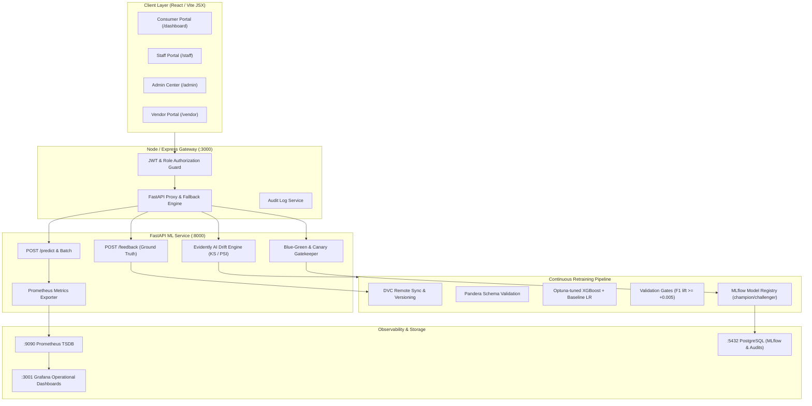
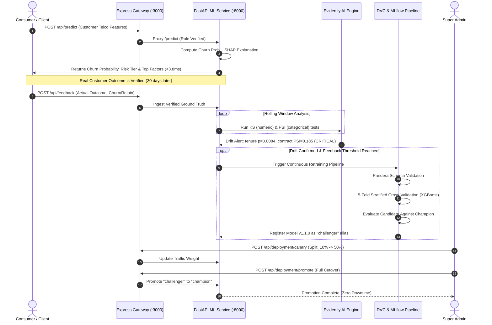

# AdaptFlow Enterprise Architecture & Closed Feedback Loop Specification

## 1. System Overview
AdaptFlow is an enterprise-grade self-adaptive machine learning system engineered to predict, monitor, and adapt to telecommunications customer churn in real time. It resolves production model decay by closing the loop between inference, ground-truth ingestion, statistical drift detection, automated DVC retraining, and Blue-Green canary deployments.

---

## 2. End-to-End Closed Feedback Sequence

